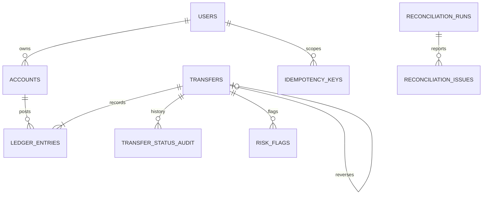

# Schema design

## Noun list
- **users**: stored because profile/contact and KYC state belong to a person.
- **accounts**: one table for wallet and system accounts; a shared ledger FK and identical balance semantics avoid special-case ledger logic. `account_type` distinguishes wallet, cash-in, cash-out and fee revenue.
- **transfers**: business intent and lifecycle, including reversal linkage and risk status.
- **ledger_entries**: immutable debit/credit facts; each references one transfer and one account.
- **idempotency_keys**: request fingerprint and exact response replay.
- **transfer_status_audit**: append-only history of status changes, actor and reason.
- **risk_rules / risk_flags**: configurable rule thresholds and per-transfer findings.
- **reconciliation_runs / reconciliation_issues**: saved run summaries and individual mismatches.
- **job_locks**: database-backed exclusion for scheduled/manual reconciliation.

## Cardinalities
- users 1:M accounts (wallets); system accounts have `user_id IS NULL`.
- transfers 1:M ledger_entries; each entry belongs to exactly one account.
- transfers 1:M status audit and risk flags.
- transfers 0:1 reversal transfer via `reversal_of` (application enforces at most one reversal).
- reconciliation_runs 1:M reconciliation_issues.
- users 1:M idempotency keys; anonymous/admin operations use the shared null-user scope.

## ER diagram

## Money and constraints
All amounts and balances are integer paise in BIGINT. Ledger amounts are positive and direction is stored separately. The trigger rejects ledger UPDATE/DELETE. Wallet non-negative balance is enforced in the locked transfer path (system accounts may be negative); PostgreSQL CHECK alone cannot compare account balance with concurrent ledger state. The app locks account rows in ascending ID order and checks funds while holding the lock. Statement index: `(account_id, created_at DESC, id DESC)`; transfer indexes support source/destination history and status queue. Email and phone are user-controlled contact attributes, unique but mutable, never primary keys.

## Balance strategy
We store a materialized account balance for quick reads and update it atomically with ledger inserts. Reconciliation independently recomputes balances from immutable ledger rows. This costs write complexity and requires nightly detection, but avoids summing the full ledger for each balance request.
